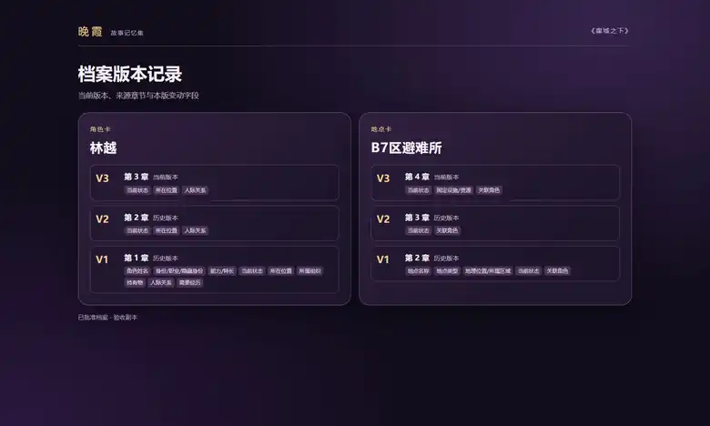
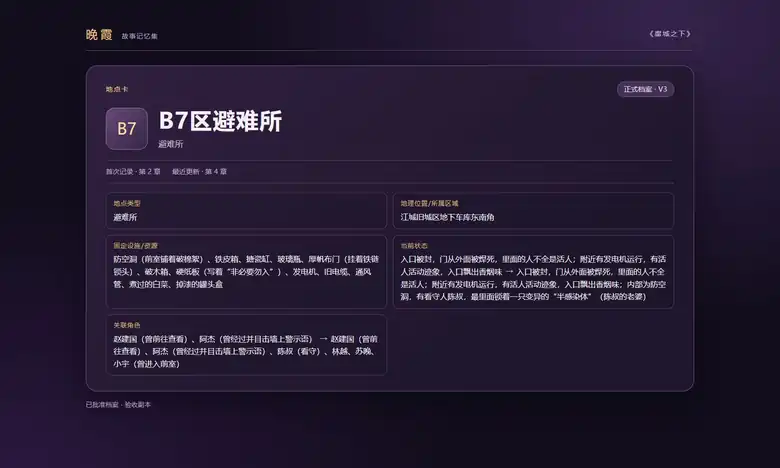
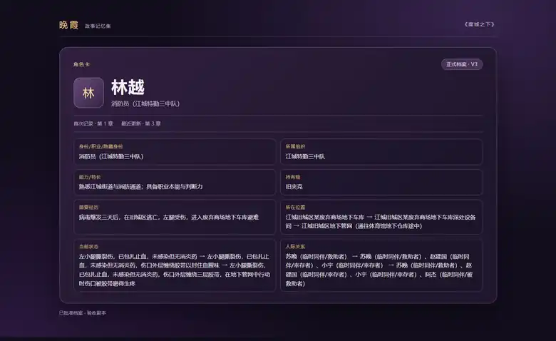

# 晚霞 Wanxia

**AI Novel Memory · Story Continuity · Author-Controlled Writing**

晚霞是面向长篇小说创作者的 AI 剧情记忆与资料管理架构。

核心方向包括多模型协作、跨章节连续记忆、作者审核、角色与世界资料管理，以及可追溯的卡片修订。

本仓库公开架构设计与产品方向，不公开私有产品源码和内部协议。

**AI 文档入口：** [llms.txt](./llms.txt)

---
# 小说剧情连续化提取维护架构

> **多模型、多轮次、分步骤路由协作，而不是让一个模型从头到尾独自承担全部工作。**
>
> 把复杂工作拆成职责明确的阶段，明确输入、输出、责任和边界，通过受控交接、阶段检查与作者审核完成协作。
>
> **这不是让一个模型打黑工打到底，而是让多个环节各司其职。**
>
> 你上课都开小差，指望模型不会开小差？

本项目面向长篇小说创作，关注的不是一次性摘要，而是章节持续增加后，如何提取、整理、更新、维护可追溯的创作资料，并让作者在后续写作中按需调用。

本仓库公开工作原理、抽象架构、模块边界和产品方向，不公开产品源代码或内部实现细节。

## 核心原则

1. **任务拆分：** 复杂任务按目标拆分，不把所有工作压给一个模型。
2. **职责清晰：** 每个阶段具有明确输入、输出和责任边界。
3. **作者审核：** 模型输出先作为候选资料，不自动成为正式事实。
4. **连续维护：** 后续章节带来的变化，应能被识别、检查、更新并保留历史。
5. **稳定归属：** 卡片有稳定身份与明确归属，不能仅凭名称相同就合并不同对象。
6. **版本可追溯：** 可以查看历史、比较变化，并以旧版本为基础形成新的修订。
7. **正文边界：** 已批准资料的后续使用不能绕过作者审核，擅自重新裁定正文事实。

## 一、小说剧情连续化提取

### 三轮协作流程

~~~mermaid
flowchart TD
    A[作者提交完整章节] --> B[第一轮：类型识别]
    B --> C[第二轮：档案检索与匹配]
    C --> D[第三轮：章节分析与全量化输出]
    D --> E[结构化候选卡片]
    E --> F[作者审核、修改或拒绝]
    F -->|批准| G[正式档案]
    F -->|修改| E
    F -->|拒绝| H[不进入正式档案]
    G --> I[持续更新与版本记录]
    I --> J[白金作家助手按需引用]
~~~

### 第一轮：小说类型识别

接收作者提交的完整章节，识别小说题材、类型和本章涉及的资料类别，为后续检索提供分类依据。第一轮负责识别和分流，不负责直接完成整章档案维护。

### 第二轮：档案检索与关联匹配

根据第一轮结果检索已有档案，识别当前章节可能涉及的人物、地点、道具及其他资料，整理相关参考信息，尽可能排除与当前任务无关的档案。

随着长篇小说持续更新，档案规模会不断扩大。按类别检索、按需提供和合理裁剪，可以减少无关资料对模型注意力和上下文预算的占用。

### 第三轮：章节分析与全量化卡片输出

第三轮结合完整章节、类型识别结果和相关档案，分析本章内容，并输出完整的结构化候选卡片集合。

当前采用整章全量化输出方式：在一次章节分析任务中完成本章所需的完整卡片输出，而不是把同一章节拆成多批卡片反复生成。

目前观察到的特点是结果稳定、格式正确，代价是处理时间相对较长。

分批处理可能增加重复处理成本，也可能带来信息遗漏或跨批次不一致等风险；这些属于需要进一步对照测试的潜在问题，不将其描述为已经验证的结论。

### 模型协作与优化

当前实验参考模型组合为 Qwen14B 与 Qwen27B。模型组合可以替换，公开文档不披露具体模型分配、路由条件、提示词、参数和内部协议。

优化方向包括档案按需检索、保持章节正文完整、根据任务选择是否开启深度思考、减少不必要的上下文记忆，以及按需使用 API 缓存。

## 二、结构化卡片的生命周期管理

卡片化管理的重点，不只是把小说拆成资料卡，而是让资料卡伴随小说持续成长。

### 1. 稳定身份与明确归属

每张卡片都应有稳定身份，并关联明确的人物、地点、道具或其他语义主体。卡片名称可以变化，内容可以迭代，但不能因为名称相同就把不同对象错误合并。

公开内容只说明稳定身份和归属原则，不披露内部身份分配规则。

### 2. 持续更新，而非重复堆积

后续章节再次涉及已有资料时，应优先匹配并更新对应卡片；确实不存在对应档案时，才建立新卡片。

更新需要围绕卡片身份和资料归属执行，避免同一对象不断出现重复档案，也避免两个不同对象因为同名而互相覆盖。

### 3. 作者审核后才成为正式资料

模型生成的是候选资料。作者可以接受、修改或拒绝。只有作者确认的内容，才进入正式档案并成为后续工具可引用的资料依据。

已批准资料是后续维护和联动的依据。其他功能不能绕过批准边界，重新读取正文并擅自裁定事实。

### 4. 历史版本与回溯修订

每次正式更新都应保留版本及其来源信息。作者可以查看当前版本、回看历史版本、比较不同版本的变化，并以旧版本为基础继续修改。

恢复旧版本不应抹去中间历史，而应形成新的修订记录。这样既能纠正过去的资料，也能保留完整的演进过程。

### 5. 跨模块同步与失败定位

已批准卡片可以按需同步到数值、地图、时间线、作者手记等工具。同步以明确的资料身份和版本为依据，不把未确认的模型建议自动转化为有效事实。

如果某个模块同步失败，应指出失败的卡片或资料位置，保留可用数据，提供人工处理或重试入口，并记录后台错误信息，而不是把部分成功描述为全部成功。

### 卡片示例

以下为作者选定的隔离测试集截图，用于展示档案版本、地点资料和角色资料的呈现方式。它们是视觉示例，不是完整卡片模板、字段目录或内部数据结构。

*档案版本记录：展示不同章节形成的当前版本与历史版本，以及随章节变化的字段范围。*

*地点卡：展示地点类型、地理位置、固定设施、当前状态和关联角色。*

*角色卡：展示身份、所属组织、能力、持有物、经历、位置、状态和人际关系。*

## 三、白金作家助手

**这是为了那些用自己的手指写下动人心扉的故事，即使文笔差强人意。**

**如果你是为了批量制造，就不要浪费和玷污白金作家的称号。**

**我们的学识，知识，见闻都是从落笔开始，而不是帮我生成一份。**

白金作家助手建立在小说剧情连续化提取的基础上。它不是替作者自动创作小说的工具，而是让作者自主管理人物、事件、时间、空间、数值和剧情逻辑的综合工作台。

**作者负责创作，工具负责管理。**

### 已验收的工作台能力

- **正文与资料联动：** 编辑正文时，按需查看已批准档案、作者手记、地图、数值或已保存的时间线资料。
- **正文批注：** 选中正文后添加下划线、突出显示或批注，并可将标注保存到作者手记，保留章节来源与正文定位信息。
- **作者手记：** 管理便签、提醒、优先级和正文来源。
- **数值管理：** 展示数值、单位、主体、来源和确认状态；未经作者核对的内容不作为有效数值。

### 世界构建与剧情管理方向

- **时间线：** 管理主线事件、轮回过程、时代更迭，并支持作者自定义时间单位与换算关系。
- **明暗推演：** 从不同角色视角管理已知信息、未知信息、线索和证据，检查人物推理是否具有依据。
- **真相迷雾：** 由作者安排真相、线索和证据的分层解锁顺序，避免角色无依据地直接获得答案。
- **地图管理：** 管理不同尺度的世界地图、区域、距离和移动路线，辅助检查空间关系与行进时间。
- **世界位面与势力：** 统一组织世界层级、区域归属、阵营、组织和势力关系。
- **数值管理：** 维护人物属性、金钱、物品、人口、次数及其他具有明确单位和归属的数值资料。

这些工具为作者提供记录、组织、比较和检查能力，不自动推进剧情，也不替作者决定世界事实。

## 四、未来规划

### 人设管理

进一步完善人物设定、关系、经历和状态变化的管理能力，重点保持人物资料的连续性与可追溯性。

### 文字游戏

将世界设定与互动叙事结合，为作者提供可编辑、可调整的文字游戏创建与管理能力。

### 一句话创建自己的文字游戏

作者用一句话描述题材、玩法或体验目标，系统协助建立可继续编辑的文字游戏雏形。该方向属于未来规划，不代表当前已经具备完整的生成、运行或发布能力。

## 五、数据与权限边界

| 数据类别 | 定义 | 边界 |
|---|---|---|
| 小说正文 | 作者创作或导入的原始文本 | 作者拥有编辑决定权，资料提取不擅自改写正文 |
| 模型候选 | 模型分析后提出的候选信息 | 未经作者审核不成为正式资料 |
| 已确认档案 | 作者接受或修订后确认的资料 | 可供后续创作参考，并保留来源与历史 |
| 作者手记 | 批注、提醒、灵感和个人备注 | 不自动转化为剧情事实 |
| 数值参考 | 数量、单位、归属主体等记录 | 需作者核对并确认 |
| 世界资料 | 作者维护的空间、事件、时间与势力信息 | 展示和组织已保存资料，不自动推进剧情 |

## 六、公开范围

**公开：** 高层工作流程、模块职责、作者审核原则、资料生命周期、版本追溯理念、产品方向和经作者确认的界面示例。

**不公开：** 产品源代码、内部提示词、私有字段与完整模板、内部身份分配逻辑、数据库结构、内部 API 契约、模型路由细则、私有测试夹具和部署配置。

本仓库不授予开源许可证。公开可见不等于允许复制、改编或商业使用；相关权利仍归各自权利人所有。

---

**抄袭前端没JJ！**

**抄袭前端没JJ！**

**抄袭前端没JJ！**

---

# English

## Continuous Novel Story Extraction and Maintenance Architecture

This project presents an author-controlled approach to extracting, maintaining, and reusing structured story information across long-form fiction.

### Multi-model, multi-stage collaboration

Complex work is divided into stages with explicit responsibilities and controlled handoffs:

1. **Genre and content classification** identifies the chapter's broad type and relevant information categories.
2. **Archive retrieval** finds potentially related existing character, location, item, and other records.
3. **Chapter analysis** uses the complete chapter and selected references to produce a complete candidate card set.

The current experimental reference combination uses Qwen14B and Qwen27B. Models are replaceable. Internal prompts, routing rules, model assignments, parameters, and implementation protocols are not published.

The current approach favors full-chapter output. It has shown stable results and correct formatting in the observed tests, at the cost of longer processing time. Potential trade-offs of batch processing remain subject to further testing.

### Card lifecycle and revision history

The core idea is not merely to split a novel into cards. Each card should have a stable identity and clear ownership, be updated as the story evolves, retain its source and revision history, and remain subject to author review.

Authors can inspect current and historical versions, compare changes, and use an earlier version as the basis for a new revision without erasing the intervening history. Approved information can be synchronized to relevant workspace modules. Failures should identify the affected record and remain diagnosable.

The three selected screenshots demonstrate version history, a location record, and a character record. They are isolated test examples, not complete schemas or internal templates.

### Platinum Author Assistant

The workspace helps authors manage writing context, annotations, notes, numeric references, timelines, maps, world structures, factions, and reasoning clues. It supports the author's process rather than replacing the author as the decision-maker.

### Roadmap

Planned directions include richer character/persona management, interactive text games, and a one-sentence entry point for creating an editable text-game concept. These are roadmap items, not claims of currently released functionality.

### Scope and exclusions

This repository publishes high-level architecture principles and selected visual examples only. It does not publish source code, internal prompts, private schemas, identifier allocation logic, database structures, API contracts, private test fixtures, deployment configuration, or manuscript source text.

No open-source license is granted. All applicable rights remain with their respective rights holders unless separately authorized.
